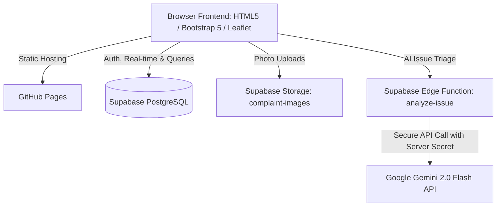

# CivicFix AI 2.0 — Setup & Deployment Guide

Welcome to the step-by-step setup guide for **CivicFix AI 2.0**. This guide explains how to configure your free Supabase database, secure Gemini AI Edge Function, and deploy the application to GitHub Pages in beginner-friendly language.

---

## Architecture Overview



---

## Part 1: Supabase Database & Security Setup

### Step 1.1: Create a Free Supabase Project
1. Visit [supabase.com](https://supabase.com) and sign in (or create a free account).
2. Click **New Project**.
3. Choose an organization, enter a project name (e.g., `civicfix-ai`), and set a strong database password.
4. Select your preferred region (e.g., `ap-south-1` for Mumbai or closest to your location) and click **Create new project**.

### Step 1.2: Execute Database Schema
1. In your Supabase dashboard, navigate to the **SQL Editor** tab (icon on the left sidebar).
2. Click **New query**.
3. Open [`supabase/schema.sql`](supabase/schema.sql) from this repository, copy its entire contents, paste it into the SQL editor, and click **Run**.
   - *This creates the `profiles`, `complaints`, and `complaint_status_history` tables along with automated audit triggers and indexes.*

### Step 1.3: Apply Row Level Security (RLS) Policies
1. In the Supabase **SQL Editor**, open another **New query**.
2. Open [`supabase/rls.sql`](supabase/rls.sql), paste its contents, and click **Run**.
   - *This enforces public read access for community transparency while strictly restricting edits so citizens cannot modify other users' reports or escalate their own privileges.*

### Step 1.4: Configure Storage for Complaint Photos
1. In the **SQL Editor**, open a **New query**.
2. Open [`supabase/storage.sql`](supabase/storage.sql), paste its contents, and click **Run**.
   - *This provisions the public bucket `complaint-images` with a 5MB per-file upload limit for JPG, PNG, and WebP.*

### Step 1.5: (Optional) Seed Sample Data
1. In the **SQL Editor**, open [`supabase/seed.sql`](supabase/seed.sql), paste and click **Run**.
   - *This populates your live database with 5 realistic civic complaints (pothole, dumpster overflow, streetlight blackout, pipeline burst, and exposed transformer box) with geographical coordinates and initial audit histories.*

---

## Part 2: Google Gemini API & Edge Function Setup

### Step 2.1: Obtain a Free Google Gemini API Key
1. Go to [Google AI Studio](https://aistudio.google.com/app/apikey).
2. Sign in with your Google account.
3. Click **Create API Key** and copy your generated key (starts with `AIzaSy...`).

### Step 2.2: Deploy the Supabase Edge Function
The Edge Function securely proxies calls to Gemini without exposing your API key to frontend client code.

1. Install the Supabase CLI on your computer (if not already installed):
   - **Windows (PowerShell)**:
     ```powershell
     scoop bucket add supabase https://github.com/supabase/scoop-bucket.git
     scoop install supabase
     # Or using npm:
     npm install -g supabase
     ```
2. Log in and link your Supabase project:
   ```bash
   supabase login
   supabase link --project-ref your-project-id
   ```
   *(Your project ID is in your Supabase dashboard URL: `https://supabase.com/dashboard/project/<your-project-id>`)*
3. Set your Gemini API key as a secure secret in Supabase:
   ```bash
   supabase secrets set GEMINI_API_KEY=your_actual_gemini_api_key_here
   ```
4. Deploy the function:
   ```bash
   supabase functions deploy analyze-issue --no-verify-jwt
   ```
   *Note: `--no-verify-jwt` allows public/guest complaint submissions to trigger the AI triage function while verifying requests server-side.*

---

## Part 3: Connecting the Frontend

### Method A: In-App Settings Modal (Zero-code setup)
1. Open `index.html` in your browser (or your live GitHub Pages link).
2. Click the **⚙️ (Settings)** icon in the top right navbar.
3. Enter your:
   - **Supabase Project URL** (e.g. `https://xyzcompany.supabase.co`)
   - **Supabase Anon Key** (from *Project Settings -> API*)
   - **Gemini Edge Function URL** (optional: defaults to `https://<your-project>.supabase.co/functions/v1/analyze-issue`)
4. Click **Save & Connect**. The page will reload and the top banner will switch to `🟢 LIVE SUPABASE MODE`.

### Method B: Code Configuration
You can also set these defaults in [`js/config.js`](js/config.js):
```javascript
export const Config = {
  supabaseUrl: "https://your-project-ref.supabase.co",
  supabaseAnonKey: "eyJhbGciOiJIUzI1NiIsIn...",
  ...
};
```

---

## Part 4: GitHub Pages Deployment

CivicFix AI 2.0 has **zero build steps** and runs as pure standard static files (HTML, CSS, modular ES6 JavaScript), making it 100% compatible with GitHub Pages:

1. Push your repository to GitHub:
   ```bash
   git init
   git add .
   git commit -m "Build CivicFix AI 2.0"
   git branch -M main
   git remote add origin https://github.com/your-username/CivicFix-AI.git
   git push -u origin main
   ```
2. On GitHub, go to your repository **Settings** -> **Pages**.
3. Under **Branch**, select `main` and root `/ (root)`.
4. Click **Save**.
5. Within 1-2 minutes, your website will be live at:
   `https://<your-username>.github.io/CivicFix-AI/`

---

## Part 5: Understanding Demo Mode

If you do not configure Supabase or Gemini credentials:
- CivicFix AI 2.0 **automatically runs in a clearly marked DEMO MODE**.
- It displays a prominent yellow banner: `🟡 DEMO MODE: Operating with realistic sample data & local AI inference.`
- You can test:
  - Form validation & image preview
  - Geolocation detection & mini-map pin dropping
  - Duplicate complaint detection warnings
  - AI triage analysis (clearly marked as `[DEMO MODE: Simulated AI output]`)
  - Leaflet interactive map with custom category markers
  - Citizen Feed with search and filters
  - Municipal Admin Portal with status updates and audit logs
  - Quick-switch between Citizen and Admin perspectives via the role dropdown
- **No falsehoods or fabricated API responses**: When in Demo Mode, the UI explicitly discloses that local simulation is active.
